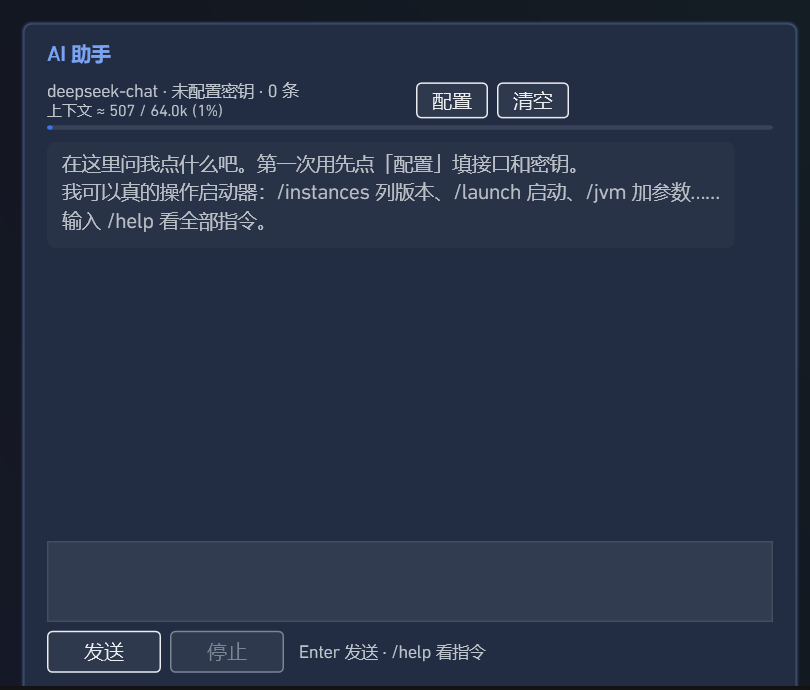

# PCL Harness AI 助手插件

内嵌在 [PCL Harness](https://github.com/Meloong-Tech/PCL-Harness) 启动页右侧卡片里的 AI 对话助手：流式输出、代码块、上下文用量可视化、历史本地保存，并且能**真的调用启动器功能**（列实例、切实例、启动游戏、改参数、管插件、管模组、读游戏日志……）。



## 安装

**依赖 PCL Harness 3.8.3 及以上（API v7）。**

1. 到 [Releases](https://github.com/Badqf/PCLH-Ai-chat-Plugin/releases/latest) 下载 `aichat-*.pclplugin`。
2. 启动器 →「插件」页 →「导入插件…」选择该文件（也可以把文件直接拖进窗口）。
3. 启用时会弹出权限确认，确认后才会加载。
4. 到「启动」页右侧卡片点「配置」，填接口地址 / 密钥 / 模型名。

| 服务 | 接口地址 | 模型名 |
| --- | --- | --- |
| DeepSeek | `https://api.deepseek.com` | `deepseek-chat` |
| OpenAI | `https://api.openai.com` | `gpt-4o-mini` 等 |
| 本地 Ollama | `http://127.0.0.1:11434` | `qwen2.5:7b` 等 |

## 特性

- **流式对话**：SSE 逐字渲染，`停止` 随时中断。
- **代码块**：识别 ```` ```lang ```` 围栏，等宽字体 + 深色底 + 语言标签。
- **用量可视化**：状态行显示 `上下文 ≈ N / 64.0k (x%) · 上次 ↑输入 ↓输出`，底部有进度条。
- **历史持久化**：存在插件自己的 `data\chat.txt`（Base64 编码正文，换行/代码块不会散架）。
- **Function calling**：15 个工具，模型自己决定调用；同一轮最多 4 次工具往返。
- **接口可换**：DeepSeek / 任意 OpenAI 兼容端点 / 本地 Ollama，界面里直接填。
- **零宿主修改**：纯插件，不改启动器本体。

## 工具清单（模型能调用的启动器能力）

| 工具 | 作用 | 权限 | 类型 |
| --- | --- | --- | --- |
| `list_instances` | 列出所有游戏实例 | `instance.read` | 只读 |
| `instance_info` | 当前实例的名称/版本/加载器/目录/能否装 mod | `instance.read` | 只读 |
| `select_instance` | 切换"当前实例"（不启动） | `instance.select` | 改状态 |
| `launch_instance` | 启动游戏 | `launch` + `instance.select` | 改状态 |
| `append_jvm_args` | 追加 JVM 参数（本次会话） | `args` | 改状态 |
| `append_game_args` | 追加游戏参数（本次会话） | `args` | 改状态 |
| `get_pending_args` | 查看已追加的参数 | `args` | 只读 |
| `list_plugins` | 列出已装插件与启停状态 | `plugins` | 只读 |
| `set_plugin_enabled` | 启用/禁用别的插件 | `plugins` | 改状态 |
| `list_mods` | 列 mods / 资源包 / 光影 + 启用状态 | `mods.read` | 只读 |
| `set_mod_enabled` | 改 `.disabled` 后缀（可逆） | `mods.write` | 改状态 |
| `read_log` | 读当前实例的游戏日志 | `logs.read` | 只读 |
| `global_setting` | 读启动器全局设置某一项 | `settings.global` | 只读 |
| `write_note` | 存笔记到 `data\notes\` | `files` | 改状态 |
| `open_url` | 用浏览器打开 http/https 链接 | `net` | 改状态 |

改状态的两个工具（`set_mod_enabled` / `set_plugin_enabled`）在调用后会**回读列表复核**，因为宿主对不存在的文件也可能返回成功。

## 安全边界

- **没有任何执行代码/命令的通道**。
- **写文件只有一条出口**：`write_note` → 插件自己 `data\notes\`，文件名白名单、限 `.md`/`.txt`、≤64 KB、强制路径校验。
- **协议白名单**：`open_url` 只放行 `http/https`，拒绝 `file:` / `javascript:` / `data:`。
- **不能碰插件自己**：`set_plugin_enabled` 硬拦 `aichat`。
- **启动器日志不对模型开放**：`read_log` 只读当前实例的游戏日志。

## 安装

1. 把 `aichat\` 整个文件夹放到启动器的 `PCLHarness\Plugins\` 下（或插件页「导入插件…」）。
2. 重启启动器 / 点插件页「重新扫描」。
3. 首次启用会弹出权限确认，确认后卡片出现在「启动」页右侧。
4. 点卡片右上「配置」填接口：

| 场景 | 接口 | 模型 |
| --- | --- | --- |
| DeepSeek | `https://api.deepseek.com` | `deepseek-chat` |
| OpenAI 兼容 | 你的端点，如 `https://api.openai.com` | `gpt-4o-mini` 等 |
| 本地 Ollama | `http://127.0.0.1:11434` | `qwen2.5:7b` 等 |

## 构建

需要 PCL Harness 的插件 SDK（含 `build.ps1` 与 .NET Framework 4.8 参考程序集）：

```powershell
build.ps1 -Project <本目录> -Launcher "PCL Harness.exe"
```

> 注意：SDK 3.8.3 的 `build.ps1` 引用清单里漏了 `System.Net.Http.dll`，本插件用 HttpClient 会报 `BC30002`。若你用的是原版 SDK，请在 `$refs` 里补一行：
> `"$ReferencePath\System.Net.Http.dll",`

产物是 `AiChat.Plugin.dll`，和 `plugin.json` 一起放进插件目录即可。

## 已知限制

- 单会话、无多轮分支；上下文固定带最近 24 条。
- 无 Markdown 富渲染，只特判代码块（粗体/斜体/标题按纯文本显示）。
- 工具结果不落盘，`上次 ↑↓` 只在本次会话有效。
- 启动器没有「列出可下载版本」的宿主 API，所以做不到"帮你装个新版本"。

## 许可

MIT
